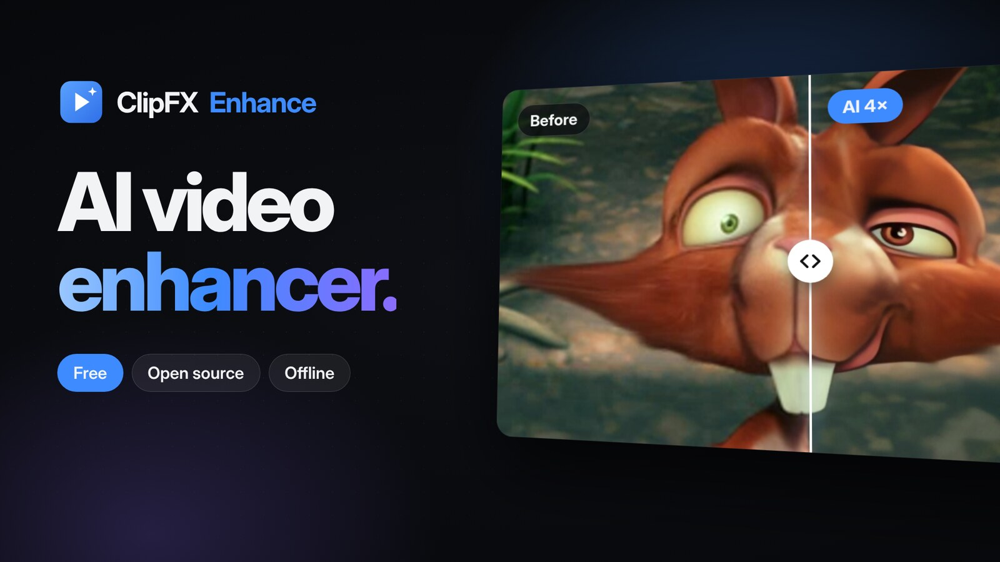
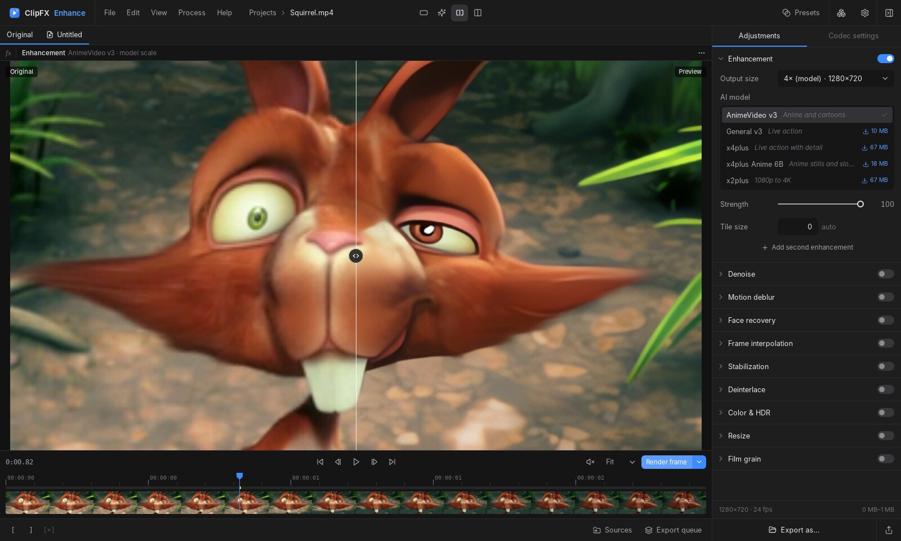
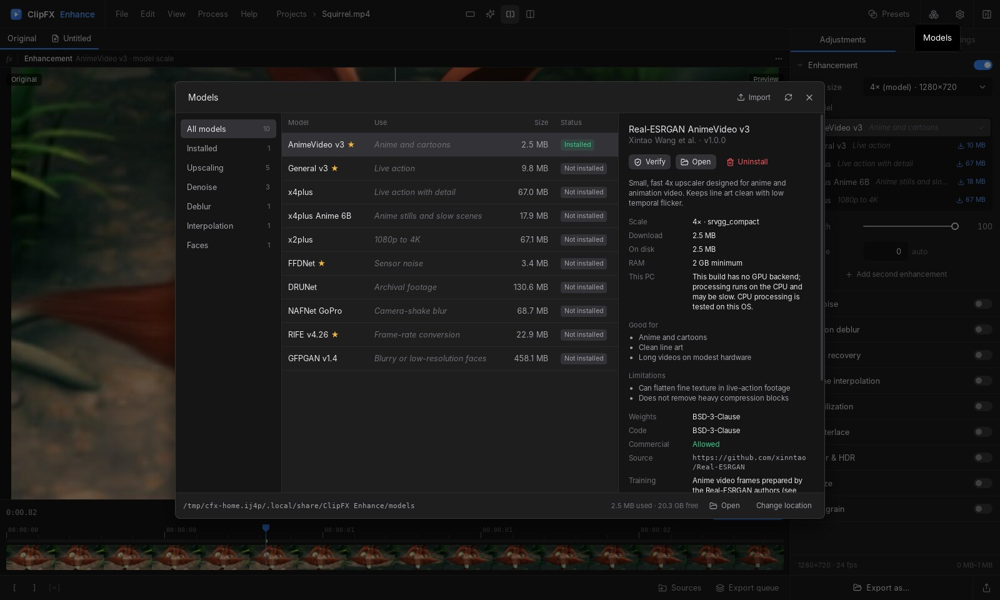
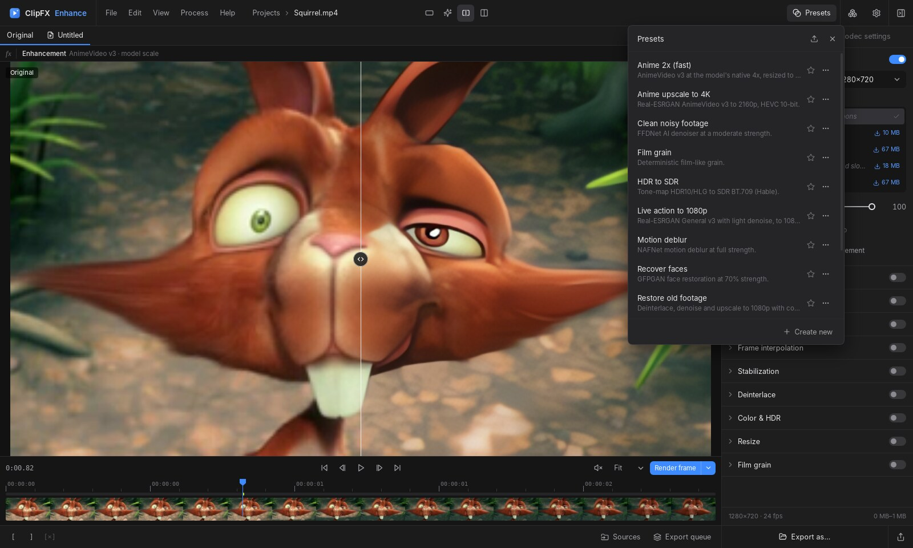
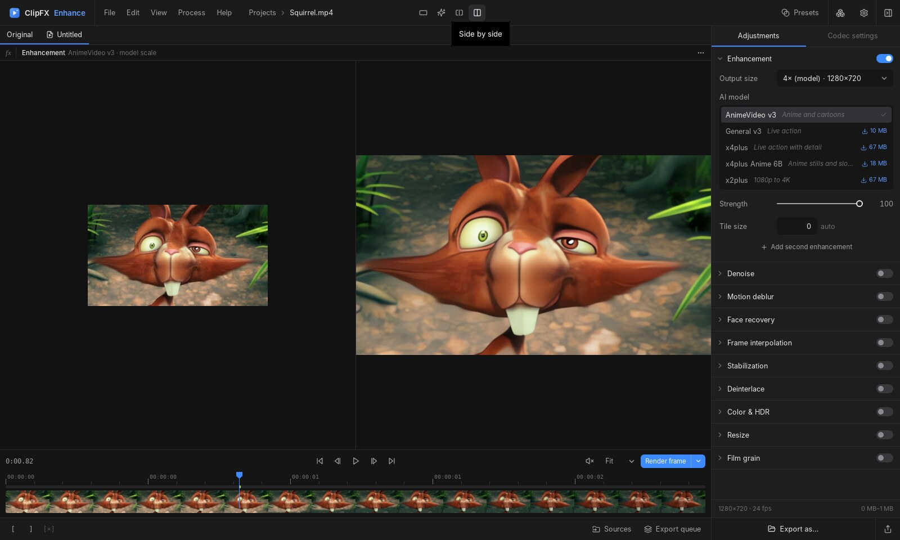
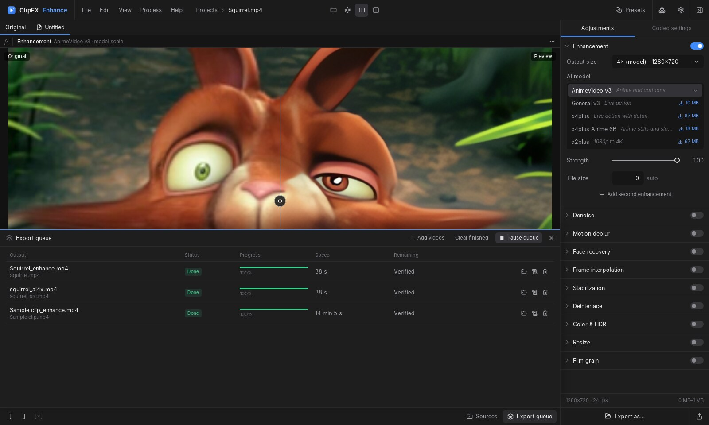

<div align="center">

<a href="https://www.clipfx.me/a/LFeCDUGg"></a>

<h1>ClipFX Enhance</h1>

<p><b>Upscale, denoise, deblur and restore video with AI, right on your own computer.</b><br>
Free and open source. No account, no subscription, no cloud.</p>

<a href="https://github.com/kuyamcliff/clipfx-enhance/releases/latest"></a>
<a href="https://github.com/kuyamcliff/clipfx-enhance/releases"></a>
<a href="#get-started"></a>
<a href="#runs-on-your-gpu"></a>
<a href="LICENSE"></a>

<a href="https://github.com/kuyamcliff/clipfx-enhance/releases/latest/download/ClipFX-Enhance-windows-x64-setup.exe"></a>&nbsp;
<a href="https://github.com/kuyamcliff/clipfx-enhance/releases/latest/download/ClipFX-Enhance-macos-universal.dmg"></a>&nbsp;
<a href="https://github.com/kuyamcliff/clipfx-enhance/releases/latest/download/ClipFX-Enhance-linux-x86_64.AppImage"></a>

<a href="https://www.clipfx.me/a/LFeCDUGg"></a>

<sub>Windows 10/11 x64 · macOS 11+ (Apple Silicon and Intel) · Linux x64 (<a href="https://github.com/kuyamcliff/clipfx-enhance/releases/latest/download/clipfx-enhance-linux-amd64.deb">.deb</a> · <a href="https://github.com/kuyamcliff/clipfx-enhance/releases/latest/download/clipfx-enhance-linux-x86_64.rpm">.rpm</a> · <a href="https://github.com/kuyamcliff/clipfx-enhance/releases/latest/download/ClipFX-Enhance-linux-x86_64.AppImage">AppImage</a>) · <a href="https://github.com/kuyamcliff/clipfx-enhance/releases/latest">all downloads</a><br>Also on <b>clipfx.me</b>: <a href="https://www.clipfx.me/a/LFeCDUGg">Windows</a> · <a href="https://www.clipfx.me/a/Scn6uqeP">macOS</a> · <a href="https://www.clipfx.me/a/AZwabs2e">Linux</a></sub>

<br><br>



</div>

<table>
  <tr>
    <td width="50%"><p align="center"><sub><b>Models.</b> Pick one, see the hardware it needs, and install it with one click.</sub></p></td>
    <td width="50%"><p align="center"><sub><b>Presets.</b> Start from a recipe or save your own.</sub></p></td>
  </tr>
  <tr>
    <td width="50%"><p align="center"><sub><b>Compare.</b> Original, preview, split or side by side.</sub></p></td>
    <td width="50%"><p align="center"><sub><b>Queue.</b> Batch exports, each one checked after it is written.</sub></p></td>
  </tr>
</table>

## What it does

| | |
|---|---|
| **Upscale** | Real-ESRGAN models for live action and animation, up to 4K and beyond |
| **Denoise** | FFDNet and DRUNet, or classic filters |
| **Deblur** | NAFNet for camera-shake and soft focus |
| **Restore faces** | GFPGAN with RetinaFace detection |
| **Smooth motion** | RIFE frame interpolation to 60 fps and slow motion up to 16× |
| **Stabilize** | Two-pass vid.stab |
| **Color & light** | Exposure, brightness, contrast, shadows, highlights, gamma, temperature, tint, saturation, vibrance and hue |
| **Sharpen** | Adaptive sharpening without halos, or unsharp mask |
| **Also** | Deinterlace, SDR ↔ HDR, resize, film grain |

Stack as many steps as you like, preview any moment against the original, and export to H.264, H.265, AV1, ProRes and more. Audio tracks, subtitles and chapters are kept, and your original file is never overwritten.

## Runs on your GPU

All AI models run on the graphics card you already have, through DirectX 12, Vulkan or Metal. That includes laptop and integrated graphics, not only high-end cards.

- **NVIDIA, AMD, Intel and Apple.** No CUDA or extra drivers to install.
- **Laptop-safe.** Work is split into short pieces sized to your GPU's measured speed, so Windows never resets the graphics driver mid-export.
- **Keeps going.** If the driver resets anyway, the app reopens the GPU and carries on. If the GPU can't run a model, that step finishes on the CPU instead of failing.
- **Stays fast in the background.** On Windows, exports aren't slowed by efficiency mode and the PC doesn't sleep until they finish.

Without a GPU, everything still works on the CPU, only slower. See [known limitations](docs/limitations.md).

## Works with the video you have

Every release is tested end to end on real footage in 20 formats, from old phone clips to HDR:

MP4 · MOV · MKV · WebM · AVI · MPG · MXF · 3GP<br>
H.264 · H.265 10-bit · AV1 · VP9 · ProRes · DNxHR · MPEG-2 · Xvid · H.263

- **Interlaced** DVD and camcorder video is deinterlaced automatically before AI steps.
- **Phone video** keeps its orientation, and variable frame rate is handled.
- **HDR stays HDR**, saved in 10-bit HEVC automatically.
- **Odd sizes, multiple audio tracks, subtitles** and non-English file names all work.

## Get started

1. **Download** for your system above and install it. FFmpeg is included on Windows and macOS.
2. Drop a video in, turn on **Enhancement**, and install the model it suggests.
3. Press **Render frame** to preview, then **Export**.

Not sure where to start? Pick a **preset** such as *Anime upscale to 4K*, *Restore old footage*, *Smooth 60 fps* or *Recover faces*, then adjust it.

**Updates.** The app tells you when a new version is out and installs it with one click on Windows and Linux. On Windows, only the app itself (a few MB) is downloaded, not the whole installer.

<details>
<summary><b>First launch on macOS</b></summary>

The app isn't notarized by Apple, which needs a paid developer account, so macOS asks before the first launch. Drag **ClipFX Enhance** to Applications and open it once. Then go to **System Settings → Privacy & Security**, click **Open Anyway**, and confirm.
</details>

<details>
<summary><b>Linux</b></summary>

The `.deb` (Debian, Ubuntu, Mint) and `.rpm` (Fedora, openSUSE) packages install FFmpeg from your distribution. For the AppImage, install `ffmpeg` with your package manager, then run `chmod +x ClipFX-Enhance-linux-x86_64.AppImage` and open it.
</details>

## Questions

<details>
<summary><b>Is it really free?</b></summary>

Yes. No account, no trial, no watermark and no export limits. The code is MIT licensed.
</details>

<details>
<summary><b>Do I need an internet connection?</b></summary>

Only to download a model the first time you use it and to get updates. Processing runs entirely on your computer.
</details>

<details>
<summary><b>How long does an export take?</b></summary>

It depends on the model, the output size and your GPU. Press **Render clip** to process a few seconds first and see how fast it goes; the queue shows speed and time left during an export. A plain 2× upscale is much faster than a 4K upscale with face recovery.
</details>

<details>
<summary><b>Something went wrong. Where is the log?</b></summary>

**Help → Show log file** opens it. It's a single file in your Documents folder, *ClipFX Enhance Log.txt*. Attach it when you [report a problem](https://github.com/kuyamcliff/clipfx-enhance/issues/new).
</details>

<details>
<summary><b>Keyboard shortcuts?</b></summary>

Ctrl+R renders a frame, Ctrl+E exports, Ctrl+Z / Ctrl+Shift+Z undo and redo, Ctrl+J opens the queue. The full list is in the [guide](docs/guide.md). Use ⌘ instead of Ctrl on a Mac.
</details>

## Privacy

Your videos never leave your computer. To find and fix problems in later versions, ClipFX Enhance
sends its own activity log: startup, errors and crashes, the settings and speed of each export,
and your hardware (CPU, memory, GPU). File paths, file names and your user name are removed
first. Logs collected while offline are sent when you are back online. Turn this off in
**Preferences → General → Privacy**.

## Build from source

```sh
cd apps/desktop && npm ci
npx tauri dev      # run
npx tauri build    # make an installer for this OS
```

You'll need Rust, Node.js 20+ and FFmpeg. The [guide](docs/guide.md) covers every feature, keyboard shortcuts, the `clipfx` command line and the tests.

## Learn more

[Guide](docs/guide.md) · [Architecture](docs/architecture.md) · [Storage](docs/storage.md) · [Support matrix](docs/support-matrix.md) · [Limitations](docs/limitations.md) · [Contributing](CONTRIBUTING.md) · [Security](SECURITY.md)

## License

MIT, see [LICENSE](LICENSE). Each AI model has its own license, which the app shows before you install it ([MODEL_LICENSES.md](MODEL_LICENSES.md)). Bundled third-party software is listed in [THIRD_PARTY_NOTICES.md](THIRD_PARTY_NOTICES.md).

<sub>Screenshot footage: <i>Big Buck Bunny</i> © Blender Foundation, CC BY 3.0. All "after" images are real ClipFX Enhance output.</sub>
